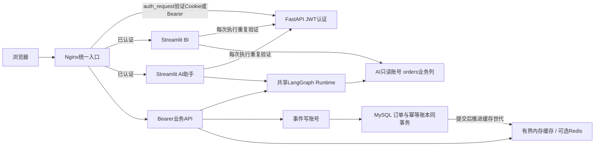
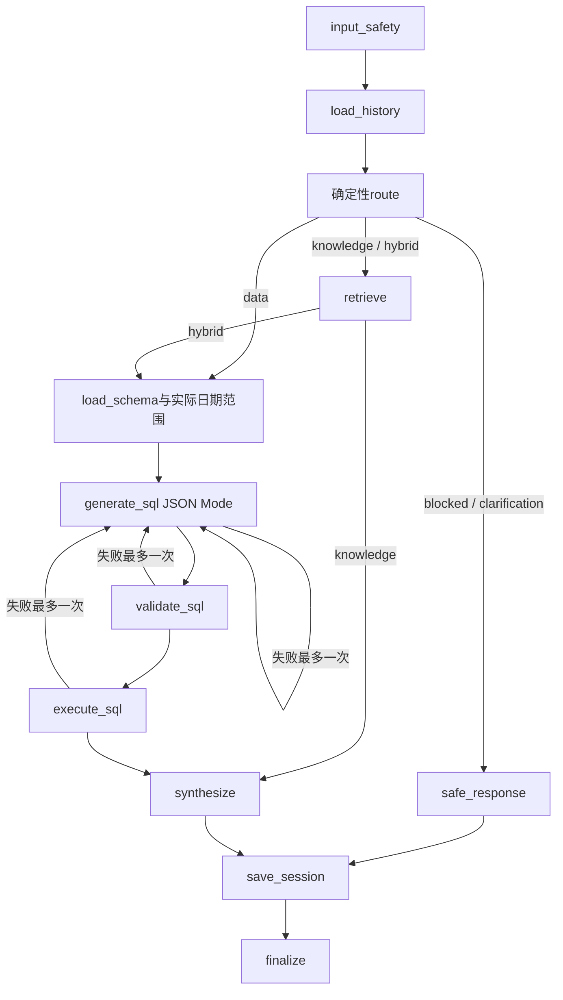
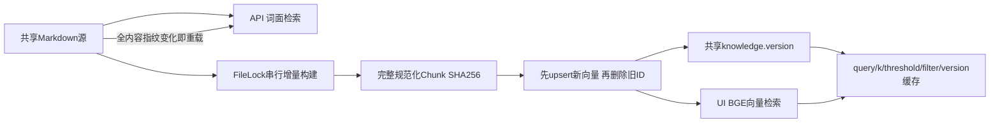

# 审计后的架构与边界

## 系统与认证



生产页面认证以服务端校验为准，不接受浏览器传入的用户名或角色。`/api/auth/login` 签发Bearer，同时设置 `ea_session` HttpOnly/SameSite=Strict Cookie；生产Cookie有Secure标记，需要HTTPS入口。`/demo` 提供现有登录表单。业务API不接受Cookie写请求，保留Bearer原则；健康检查按原有策略公开。Streamlit端口仅允许内部访问，Nginx保护HTML、静态资源与WebSocket握手；直接访问开发端口时脚本门禁仍阻止业务代码执行，但Streamlit通用HTML壳不等同于HTTP 401。

服务端模型Key不进入浏览器输入框，只发送到运维配置的Base URL。自定义服务需要用户自己的Key，而且主机仍需列入运维控制的 `MODEL_ALLOWED_HOSTS`。每次出站连接检查全部DNS答案，拒绝非公共IP/组播，连接绑定已验证IP，TLS证书继续按原域名验证；禁止重定向与环境代理。认证服务的内部HTTP地址属于单独的可信部署配置，不开放给用户编辑。

## LangGraph与SQL



SQL安全链为：结构化生成 → 单条MySQL AST → scope解析物理表/CTE/别名 → schema列校验 → 标识列使用位置限制 → 函数/语法白名单 → 复杂度、JOIN、LIMIT/OFFSET上限 → 数据库执行时限 → 引擎只读守卫 → 实际仅SELECT的独立账号。生产启动使用SHOW GRANTS核验权限，不以用户名猜测是否只读。`user_name/order_id/order_seq_id`只允许去重计数，用户行为内部可按用户名分组但不得投影用户名。复杂跨用户明细查询会被拒绝，需要改为匿名分布或人数统计。

数据库账号的SELECT权限本身无法表达“某列只能COUNT”；该限制由AST实现。账号负责禁止写入和跨表读取，两层解决不同问题。LIMIT不能限制全部中间计算，因此另外拒绝恒真/OR/单来源JOIN、递归CTE、未知函数，并下推MySQL MAX_EXECUTION_TIME；不宣称拥有完整成本优化器。

SQL失败时LangGraph直接返回失败，不进入模型猜测数值；知识问答无来源时直接拒答。检索内容标注为不可信参考数据，来源区块只取自实际元数据；被拦截问题保存为占位符，防止下一轮history把敏感内容再次发给模型。自然语言生成仍不能形式化保证无幻觉，相关限制见评测报告。

## RAG更新与缓存



Chroma写入前后推进版本；检索写缓存前再检查版本与本地失效世代。Filter使用规范化JSON，返回值深拷贝，避免调用者修改缓存。源目录不存在时先失败，最后一个源文件删除时清理全部旧向量；重复Chunk去重。失败不能报告成功。Chroma跨多个写操作没有事务快照：并发查询可能看到构建过程的过渡内容；生产大规模重建应在维护窗口进行，本次未引入双库切换组件。

API与UI仍使用两种检索器；同一冻结集已比较，Hybrid未证明提升且拒答不足，因此没有贸然启用。不能声称两个入口的来源排序完全一致。Reranker未安装、未评测。

## 业务数据与一致性

默认有效订单为 `order_status='ACTIVE' AND COALESCE(is_refund,'否')<>'是'`；销售额为实付金额合计，订单量/用户数去重，客单价为有效销售额除以有效订单数。退款率与退款金额单独对非取消订单统计。API、AI提示和BI使用此口径。AI实际生成是否遵循口径还需有效模型凭据验收，本次真实数据库测试验证共享SQL/数据函数，不冒充模型正确率。

“最近N天”锚定实际最大order_date，含末日共N个自然日。事件时间落库为UTC，历史CSV无原始时区信息，保留其源日期，未推测性平移。BI数据库模式每次刷新读取已提交数据；静态CSV模式明确提示不包含后续事件。最终AI答案缓存已移除，避免数据或会话变化后继续返回旧答案。

订单ID由数据库AUTO_INCREMENT分配；历史卷先执行0002迁移。event_id唯一约束保证幂等；FOR UPDATE与版本水位保护已有订单；事件连接使用READ COMMITTED避免不存在订单的间隙锁竞争。账本与读模型同事务，提交后失效analytics/rfm；标签世代进入缓存Key，进行中的旧计算不能污染下一代。当前Docker单worker；RFM完整快照仍是进程内缓存，多worker与Redis故障期间的跨进程一致性需额外验证。

## 可复现运行

```powershell
# 后端：配置backend/.env的独立只读账号、JWT与密码，再升级数据库
.venv\Scripts\python.exe -m alembic -c backend/alembic.ini upgrade head
.venv\Scripts\python.exe -m uvicorn backend.main:app --host 127.0.0.1 --port 8000

# 另开终端启动BI/助手；本地HTTP须显式DEBUG=true；先访问 :8000/demo 登录
$env:DEBUG='true'
$env:AUTH_BACKEND_URL='http://localhost:8000'
# BI可选：配置AI_DB_*、DB_*后设BI_DATA_MODE=database；否则为标注的静态演示
.venv\Scripts\streamlit.exe run streamlit_app.py --server.port 8501
.venv\Scripts\streamlit.exe run ai-ecommerce-assistant/app.py --server.port 8505

# 只有本地DEBUG允许显式AI_DB_ALLOW_MAIN_FALLBACK=true；生产禁止。
# SQLite助手演示必须显式AI_DATA_MODE=demo，不能静默代替生产数据库。

# 全量测试含真实MySQL，使用可创建临时schema/测试账号的隔离测试凭据
$env:RUN_DOCKER_AUTH_TESTS='1'
.venv\Scripts\python.exe -m pytest -q --tb=short
.venv\Scripts\python.exe -m ruff check agent_core backend ai-ecommerce-assistant streamlit_app.py scripts
.venv\Scripts\python.exe -m compileall -q agent_core backend ai-ecommerce-assistant streamlit_app.py scripts

# 评测命令与限制见EVALUATION_REPORT.md
```

Docker启动仍使用 `docker compose up -d --build`，新增 `db-permissions` 必须在迁移完成后、业务服务启动前成功。只更新代码镜像而不执行权限初始化和迁移不能获得本次安全保证。生产必须配HTTPS及有效密码哈希；本次未部署公网服务、未修改真实env或发布镜像。
